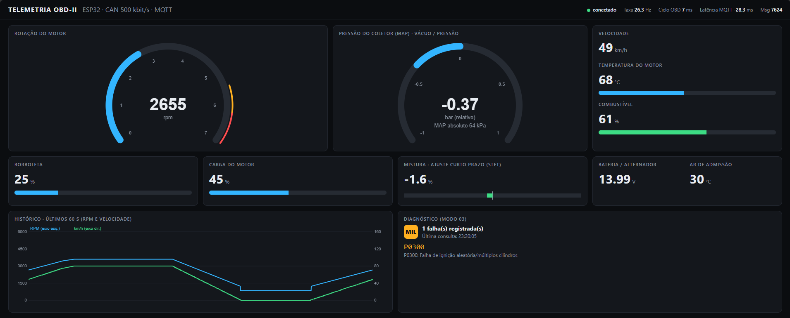
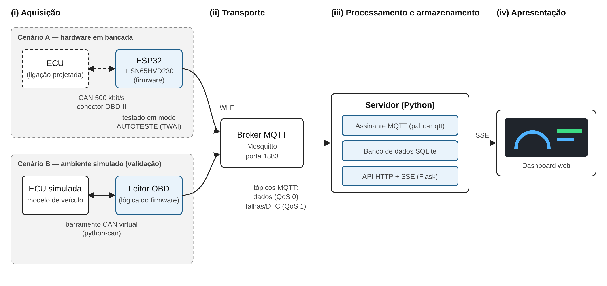
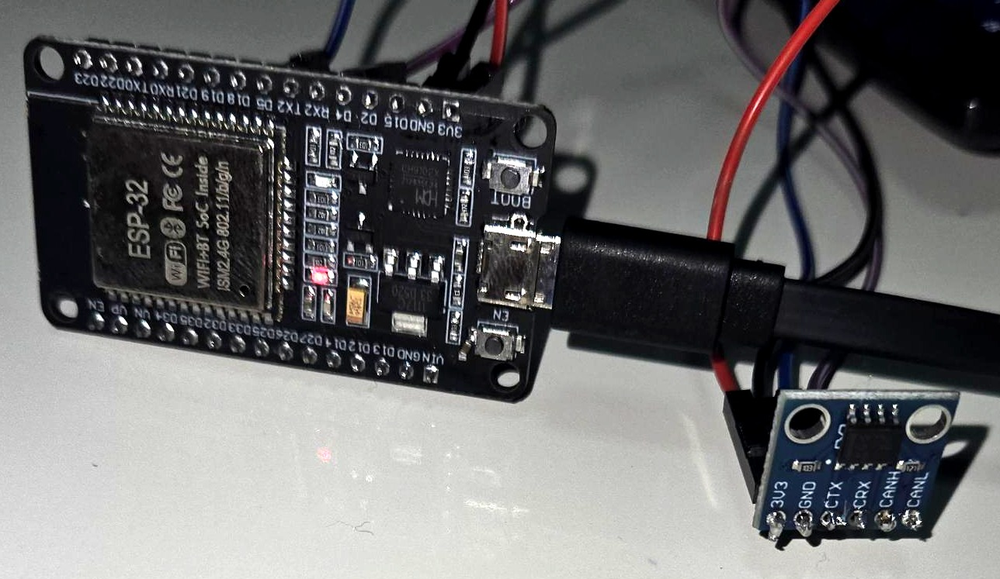
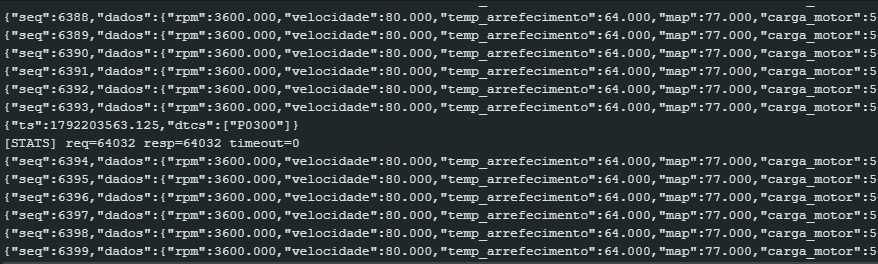

# Telemetria e diagnóstico veicular de baixo custo com ESP32 e protocolo CAN

Código-fonte, dados e figuras do Trabalho de Conclusão de Curso
**"Telemetria e diagnóstico veicular de baixo custo com ESP32 e protocolo CAN: validação em ambiente simulado e em bancada"**
— Engenharia da Computação, Centro Universitário IBMR (2026).

**Autores:** Elias Borges Viana e Arthur Silva de Cerqueira · **Orientador:** Prof. Francisco José Rodrigues da Silva Junior

O sistema lê parâmetros do motor (OBD-II, Modo 01) e códigos de falha (Modo 03) pelo barramento CAN
(ISO 15765-4, 500 kbit/s, identificadores de 11 bits). Os dados são publicados via MQTT, gravados em SQLite e
exibidos em tempo real em um dashboard web. A leitura usa o controlador CAN (TWAI) que já vem dentro do ESP32,
ligado a um transceptor SN65HVD230, sem adaptadores ELM327 nem controladores CAN externos.



## Como o sistema foi validado

O trabalho foi validado em dois níveis. A validação em um veículo é a próxima etapa e **não** faz parte deste repositório.

| Nível | O que roda | O que foi medido |
|---|---|---|
| **Ambiente simulado** (ensaios E1 a E4) | Uma ECU virtual em Python, que segue a ISO 15765-4, conversa com um leitor que reproduz a lógica do firmware por um barramento CAN virtual (python-can) | Erro de decodificação, tempo de resposta, taxa de atualização, latência MQTT e detecção de falhas |
| **Bancada** (ensaio E5) | O firmware roda no ESP32 ligado ao SN65HVD230, em modo de autoteste do controlador CAN, e publica via Wi-Fi para o notebook | Funcionamento contínuo do hardware, tempo de ciclo, perdas de mensagens e leitura de falhas |

Os parâmetros e as faixas de valores do modelo de simulação têm como referência um compacto 1.6 aspirado
(Volkswagen Polo 1.6 2009/2010), com base em sua ficha técnica.



## Principais resultados

| Indicador | Resultado |
|---|---|
| Requisições no ensaio E1 (240 s, simulação) | 21.040, todas respondidas, sem perdas nem estouros de tempo |
| Erro máximo de decodificação | 0,12 rpm (rotação), 0,50 °C (temperaturas), 0,20 p.p. (percentuais) — sempre ≤ metade da resolução da SAE J1979 |
| Tempo médio de resposta por PID (simulação) | 11,31 ms |
| Atualização dos 10 parâmetros (simulação) | 8,8 Hz (ciclo de 113,3 ms) |
| Latência MQTT média (mesmo computador) | 0,64 ms |
| Detecção da falha P0300 (E4, 30 injeções) | média de 0,88 s; mínimo de 0,002 s; máximo de 1,99 s |
| Ciclo de 10 PIDs no ESP32 (E5, 60 min em bancada) | 6,48 ± 0,09 ms, sem nenhum timeout |
| Mensagens entregues via Wi-Fi (E5, 60 min) | 98,1% — as perdas ficaram concentradas em duas desconexões da rede |

## Estrutura do repositório

```
firmware/telemetria_esp32/   firmware Arduino do ESP32 (TWAI + SN65HVD230), modos AUTOTESTE e VEÍCULO
  ├─ telemetria_esp32.ino    driver CAN, Wi-Fi, NTP, MQTT e laço principal
  └─ obd.h                   núcleo OBD-II sem dependência de hardware (fórmulas, quadros, ECU emulada)
firmware/teste_host/         teste automatizado do obd.h no computador (g++): 10.010 casos
software/                    ECU simulada, leitor OBD, servidor (MQTT + SQLite + web), dashboard e ensaios
resultados/simulacao/        dados brutos dos ensaios E1 a E4
resultados/bancada_esp32/    dados do ensaio E5 (janela de 306 s e ensaio de 60 min)
figuras/                     figuras e fotos usadas no TCC
figuras_src/                 fontes HTML/SVG dos diagramas
```

## Ensaios e arquivos de dados

| Ensaio | Onde roda | Script | Arquivos |
|---|---|---|---|
| V – verificação do núcleo do firmware | computador (g++) | `firmware/teste_host/teste_obd.cpp` | saída no terminal |
| E1 – exatidão, tempos e latência (240 s) | simulação | `software/experimentos.py` | `resultados/simulacao/e1_*.csv`, `resultados.json` |
| E2 – sensibilidade ao tempo de resposta da ECU | simulação | `software/experimentos.py` | `resultados.json` (chave `E2`) |
| E3 – escalabilidade pelo número de PIDs | simulação | `software/experimentos.py` | `resultados.json` (chave `E3`) |
| E4 – tempo de detecção de falha (30 repetições) | simulação | `software/ensaio_dtc.py` | `resultados/simulacao/e4_dtc.csv` |
| E5 – firmware no ESP32 em bancada (autoteste) | ESP32 + SN65HVD230 + Wi-Fi | `firmware/telemetria_esp32` + `software/servidor.py` | `resultados/bancada_esp32/*.csv`, `esp32_resumo.json` |

Os gráficos do TCC são gerados com `python software/graficos.py`.

## 1. Simulação completa no computador (sem ESP32)

1. Instale o Python 3.10 ou mais novo e o broker [Mosquitto](https://mosquitto.org/download/).
2. Instale as dependências: `pip install -r software/requirements.txt`
3. Dentro da pasta `software/`, abra três terminais:
   ```
   mosquitto -v
   python servidor.py                                  # dashboard em http://localhost:5000
   python simulacao.py --dtc P0300 --dtc-em 30         # ECU simulada + leitor; injeta a falha aos 30 s
   ```
4. Para repetir os ensaios: `python experimentos.py` (cerca de 8 min), `python ensaio_dtc.py` (cerca de 5 min) e `python graficos.py`.

Para conferir o núcleo do firmware no computador:
```
g++ -std=c++17 -I firmware/telemetria_esp32 firmware/teste_host/teste_obd.cpp -o teste_obd && ./teste_obd
```

## 2. ESP32 em modo AUTOTESTE (bancada, sem veículo)



1. Na Arduino IDE, instale o núcleo **esp32 by Espressif** (testado na versão 3.3.12) e a biblioteca **PubSubClient** 2.8.
2. Faça as ligações:

   | ESP32 | SN65HVD230 |
   |---|---|
   | GPIO5 | CTX |
   | GPIO4 | CRX |
   | 3V3 | 3V3 |
   | GND | GND |

3. Em `telemetria_esp32.ino`, deixe `#define MODO_AUTOTESTE 1` e preencha `WIFI_SSID`, `WIFI_SENHA` (rede de 2,4 GHz)
   e `MQTT_BROKER` (IP do computador que roda o Mosquitto). **Não publique a sua senha do Wi-Fi.**
4. No Mosquitto 2.x, para aceitar conexões da rede, acrescente ao `mosquitto.conf`:
   ```
   listener 1883
   allow_anonymous true
   ```
   No Windows, libere também a porta 1883 no firewall.
5. Grave a placa, abra o Monitor Serial (115200 baud) e rode `python servidor.py`. Os dados aparecem no mesmo dashboard.

No modo autoteste, o controlador TWAI opera sem confirmação de outro nó e recebe os próprios quadros, e o firmware
responde como uma ECU emulada. A falha P0300 aparece 30 s após a inicialização.



## 3. Uso em veículo (modo VEÍCULO)

Use `#define MODO_AUTOTESTE 0` e ligue CANH ao pino 6, CANL ao pino 14 e GND aos pinos 4 e 5 do conector OBD-II.
O veículo precisa usar diagnóstico sobre CAN (ISO 15765-4, 500 kbit/s, 11 bits). Para uso no carro, a alimentação
pelo pino 16 (+12 V) exige regulador step-down, proteção contra inversão de polaridade e supressão de transientes,
e o resistor de terminação de 120 Ω do módulo deve ser retirado.

> Esse modo foi implementado e compilado, mas **não foi validado em veículo** neste trabalho.

## Limitações conhecidas

- As mensagens são publicadas com QoS 0 e não ficam guardadas durante uma desconexão do Wi-Fi.
- Só respostas em quadro único são tratadas (Modos 01 e 03 com até dois DTCs); mensagens longas, como o VIN (Modo 09), exigem ISO-TP completo.
- O firmware não consulta antes os PIDs suportados pelo veículo (PID 0x00).
- No ensaio em bancada, a latência não foi medida em valor absoluto, por diferença entre os relógios do ESP32 (NTP) e do computador.

## Como citar

VIANA, E. B.; CERQUEIRA, A. S. de. **Telemetria OBD-II com ESP32, CAN e MQTT**: código-fonte e dados do trabalho
de conclusão de curso. [S. l.]: GitHub, 2026. Disponível em: https://github.com/eliasbr14-cell/telemetria-obd-esp32.

## Licença

MIT — veja `LICENSE`.
